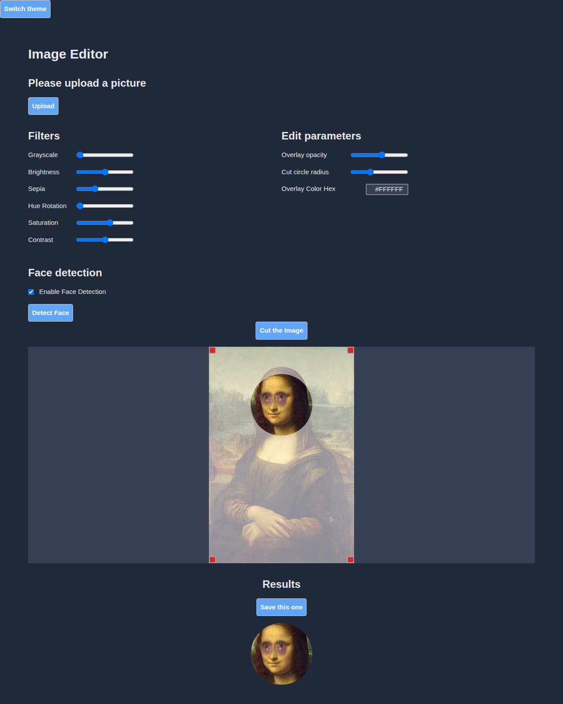

# Svelte Photo Editor

[](https://github.com/Bratishques/svelte-photo-editor/actions/workflows/ci.yml)

A small in-browser image editor built with Svelte and the Canvas 2D API. You upload a photo,
adjust colour filters, place a circular selection over it and cut that circle out as a PNG.
An optional face-detection mode uses [face-api.js](https://github.com/justadudewhohacks/face-api.js)
to find the eyes and draw a sticker over them.

Everything runs in the browser; images are never uploaded anywhere.

**Live demo:** https://bratishques.github.io/svelte-photo-editor/ (deployed from `main` by GitHub Actions)



<sub>Sample image: *Mona Lisa* by Leonardo da Vinci, public domain, via Wikimedia Commons.</sub>

## Background

This was my first Svelte project, written in February 2021 to learn the framework and the Canvas API.
In 2026 I moved it from the original Rollup template to Vite, Svelte 5 and Tailwind CSS 3 so it
installs and builds on current Node.js, added type checking, CI and a GitHub Pages deployment,
and fixed a few small bugs. The editor logic itself is still the 2021 code.

## Features

- **Upload** an image from disk. Images wider than the editor area are scaled down to fit.
- **Filters**: grayscale, brightness, sepia, hue rotation, saturation and contrast, applied live
  through the canvas `filter` property.
- **Circular selection**: drag on the image to move the circle; the radius slider is limited so the
  circle always stays inside the image. The area outside the circle is dimmed with an overlay whose
  opacity and colour (any CSS colour, applied on Enter or blur) can be changed.
- **Resize** the image on the canvas by dragging the red corner handles.
- **Face detection** (optional): detects a single face with the SSD MobileNet v1 detector and the
  tiny 68-point landmark model, then paints an eye image over each eye, rotated to the eye's tilt.
  The library and the model weights (~5.6 MB) are loaded only when you first click *Detect Face*.
- **Cut** the circle out of the current image (with filters and eye overlay applied).
  Each cut is added to the *Results* list and can be saved as a PNG file.
- **Light and dark theme**, defaulting to the system preference.

## Limitations

These are known and left as they are:

- Mouse only: moving the circle and the resize handles do not support touch or keyboard.
- The eye overlay is drawn onto the photo canvas, so changing any filter or selection parameter
  afterwards redraws the photo and removes it. Run face detection last, right before cutting.
- Only one face per image is detected.
- The cut uses the on-screen (possibly scaled) canvas, so its resolution matches what you see,
  not the original file.
- There is no undo.

## Tech stack

- [Svelte 5](https://svelte.dev/) (components are written in Svelte 3 syntax, which Svelte 5 still supports)
- TypeScript, checked with `svelte-check` in strict mode
- [Vite](https://vite.dev/) for the dev server and production build
- [Tailwind CSS 3](https://tailwindcss.com/)
- [face-api.js](https://github.com/justadudewhohacks/face-api.js) (TensorFlow.js) for face and landmark detection
- Canvas 2D API for drawing, filtering and cutting
- GitHub Actions for CI and GitHub Pages deployment

## Running locally

Requires Node.js 20.19+ or 22.12+.

```bash
git clone https://github.com/Bratishques/svelte-photo-editor.git
cd svelte-photo-editor
npm ci
npm run dev        # http://localhost:5173
```

Other scripts:

| Command           | What it does                                  |
| ----------------- | --------------------------------------------- |
| `npm run build`   | Production build into `dist/`                 |
| `npm run preview` | Serve the production build locally            |
| `npm run check`   | Type-check `.ts` and `.svelte` files          |

The build uses a relative base path, so `dist/` can be served from a domain root or a sub-path.

## Project structure

```
index.html                  Vite entry page
public/
  models/                   face-api.js model weights (SSD MobileNet v1, tiny 68-point landmarks)
  eyes/stoned/              eye overlay images
src/
  main.ts                   mounts the app
  App.svelte                context providers + layout
  PhotoEditor.svelte        upload, resize handles, cutting, results list
  PhotoCanvas.svelte        stacked canvases: photo, face layer, overlay with the circular hole
  FilterInputs.svelte       filter sliders
  ParamsInputs.svelte       overlay opacity, circle radius, overlay colour
  FaceInputs.svelte         face detection and eye overlay drawing
  ResultCanvas.svelte       one cut result with a PNG download button
  ThemeSwitcher.svelte      light/dark toggle
  context/                  components that provide shared Svelte stores via context
  lib/context.ts            typed getters/setters for those contexts
  lib/faceapi.ts            lazy face-api.js model loading
.github/workflows/          CI (type check + build) and GitHub Pages deployment
```

## Possible improvements

- Keep the eye overlay on its own layer so it survives filter changes, and offer more overlay styles.
- Pointer events for touch support and keyboard controls for the selection.
- Cut from the full-resolution image instead of the scaled canvas.
- Undo/redo and a reset button for filters.
- Replace the unmaintained face-api.js with a maintained fork or MediaPipe.
- Component tests and an end-to-end test of the upload → cut → save flow in CI.

## License

[MIT](LICENSE) © Viktor Nikulin
